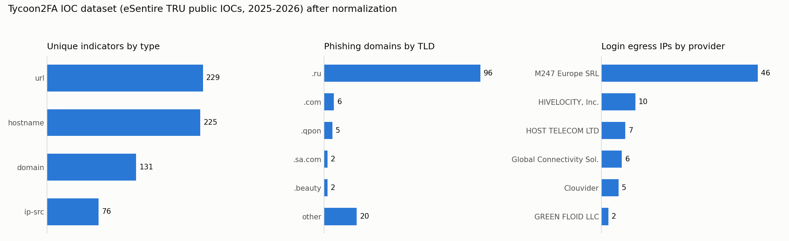
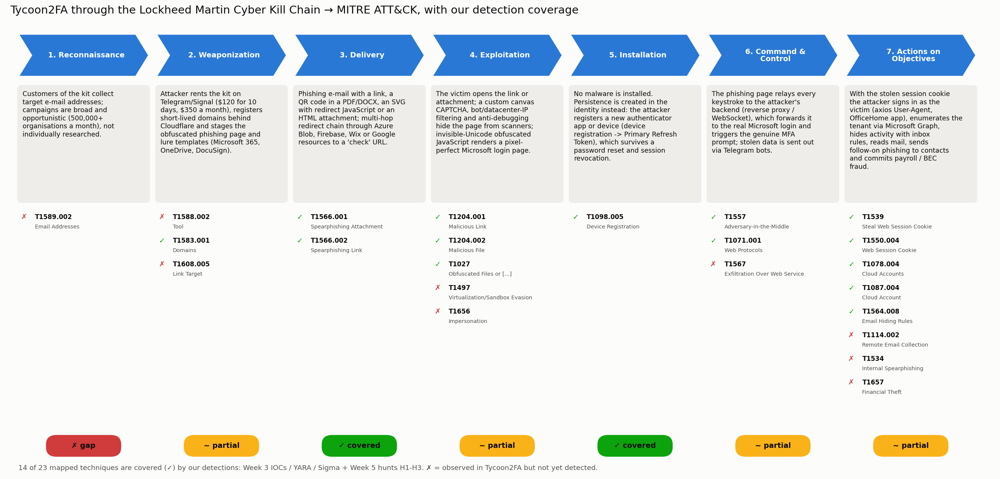
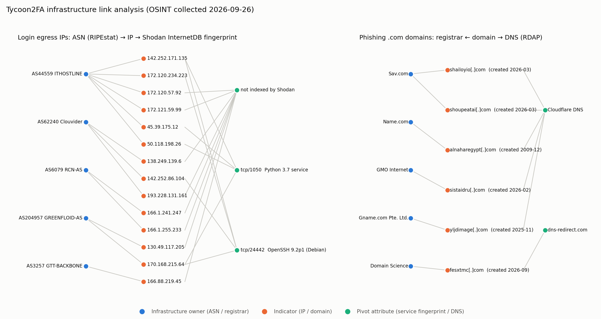

# CTI Group Project: Tycoon2FA AiTM Phishing-as-a-Service

**Course:** Introduction to Threat Hunting, Astana IT University, 2026–2027  
**Group:** CS-2426  
**Members:** Dilnaz Estaikyzy, Ademi Akmaganbet

## About the project

This project studies how a modern **Phishing-as-a-Service (PhaaS)** platform works and how it can be detected, using threat intelligence methods. Our case study is **Tycoon2FA**, an *Adversary-in-the-Middle (AiTM)* phishing kit that has been active since August 2023. Microsoft attributes it to Storm-1747.

Tycoon2FA is rented to other criminals as a ready-made service. It places a reverse proxy between the victim and the real Microsoft 365 or Google login page, and steals passwords, MFA codes and session cookies in real time. This allows attackers to bypass most common MFA methods. The kit hides from analysts with obfuscated JavaScript (including invisible Unicode characters), CAPTCHA filtering and anti-debugging code.

We follow the course's weekly structure. Each week adds one step of the threat intelligence cycle to the same case:

1. Build the theory base: glossary and threat classification.
2. Collect OSINT data about the kit and its infrastructure.
3. Process the data: build an IOC dataset, then filter and normalize it, store it in MISP, and write and test detection rules (YARA, Sigma).
4. Map the attack to the Cyber Kill Chain and MITRE ATT&CK and measure our detection coverage.
5. Hunt for the gaps with hypothesis-driven threat hunting and turn the best hunt into a detection.
6. Study a single technique in depth (T1557) and simulate it; use a MITRE CAR analytic in the SIEM.
7. Build an adversary emulation plan (ATT&CK + MITRE CALDERA) and use it to validate our detections.
8. Run Atomic Red Team tests and record/analyze them in the SIEM; study a real APT group (APT29) and map its TTPs.

## Weekly progress

| Week | Syllabus topic | Task (syllabus §3.3) | Practical work done | Report |
|---|---|---|---|---|
| 1 | Cyber Threat Intelligence Fundamentals | Glossary of CTI terms; classify threats and their sources | 26-term glossary, threat-type and source classification, Admiralty rating of our own sources | [`week1_glossary_classification_en.md`](week1_glossary_classification_en.md) |
| 2 | Data Collection Process | OSINT with Shodan, VirusTotal, Maltego; data source mapping | 377 raw IOCs collected; 14 IPs enriched with Shodan + RIPEstat; 6 domains with RDAP; Maltego import tables and link graph; VirusTotal script | [`week2_osint_collection_en.md`](week2_osint_collection_en.md) |
| 3 | Data Processing and Exploitation | Deploy MISP and import IOCs; filtering and normalization | Processing script → 667-indicator dataset + MISP event; filtering of stale / false-positive IOCs; 2 YARA rules (6/6 tests passed); Sigma rule + hunt | [`week3_misp_iocs_en.md`](week3_misp_iocs_en.md) |
| 4 | The Cyber Kill Chain | Analyze a real-world attack with the Kill Chain; map each stage to ATT&CK TTPs | Tycoon2FA analysed through 7 stages, mapped to 23 ATT&CK techniques; ATT&CK Navigator layer; coverage measured (11/23 = 47%); courses-of-action matrix | [`week4_kill_chain_en.md`](week4_kill_chain_en.md) |
| 5 | Threat Hunting Concept | Build a hypothesis-driven hunting scenario; execute hunt queries in Splunk or ELK | 4 hunts (1 intel-driven, 3 hypothesis-driven) over a 4,858-event Microsoft 365 dataset with 3 hidden intrusions; ES\|QL, EQL and SPL queries, executed in Elastic Cloud; all 3 victims found, 0 false positives; new Sigma correlation rule; ATT&CK coverage 47% → 60% | [`week5_threat_hunting_en.md`](week5_threat_hunting_en.md) |
| 6 | The ATT&CK Framework | Study one technique in depth; simulate an attack and map it to ATT&CK | Deep dive on **T1557** (Adversary-in-the-Middle); a safe localhost simulation of the AiTM relay (dummy data) reproducing the full chain; 7 attacker actions mapped to 5 ATT&CK techniques; Navigator layer + mechanism diagram | [`week6_attack_technique_en.md`](week6_attack_technique_en.md) |
| 7 | Using MITRE CAR | Select a CAR analytic and implement it in a SIEM; map it to ATT&CK | Implemented **CAR-2013-02-008 (Simultaneous Logins)** adapted to cloud sign-ins (ES\|QL + SPL); run over the dataset: 2/3 accounts, 0 false positives; mapped to T1078.004 / T1557 / T1550.004 (defence in depth) | [`week7_mitre_car_en.md`](week7_mitre_car_en.md) |
| 8 | Adversary Emulation | Build a simple emulation plan (initial access → persistence → exfiltration); document it with ATT&CK | 9-step plan across 5 phases → 9 ATT&CK techniques, written as a **MITRE CALDERA** adversary profile + abilities (safe placeholder commands); safe dry-run; **8/9 steps map to detections we built** (purple-team validation); Navigator layer + diagram | [`week8_emulation_plan_en.md`](week8_emulation_plan_en.md) |
| 9 | Atomic Red Team | Run selected atomic tests; record and analyze the results in a SIEM | **Atomic Red Team–style** suite of 6 tests (the required T1059/T1003 examples + 4 for our own techniques), all safe placeholders; runner records **37 SIEM events** (Week 5 schema) and analyzes them; **4/6 detected** by our hunts/Sigma, 2 endpoint examples out of scope (honest coverage boundary); ES\|QL/SPL + Navigator layer | [`week9_atomic_red_team_en.md`](week9_atomic_red_team_en.md) |
| 10 | Learning APT Techniques | Analyze the TTPs of APT29 or APT41; map them to MITRE ATT&CK | Analyzed **APT29** (Cozy Bear / Midnight Blizzard, SVR); **16 TTPs mapped to ATT&CK** + Navigator layer; overlap analysis vs Tycoon2FA — **7 shared + 2 related** techniques, so our detections already cover part of a nation-state actor; 7 APT29-only gaps as future work | [`week10_apt_techniques_en.md`](week10_apt_techniques_en.md) |

## Dataset

The processed dataset is [`dataset/tycoon2fa_iocs.csv`](dataset/tycoon2fa_iocs.csv); every column is described in [`dataset/README.md`](dataset/README.md). The same indicators, ready for MISP import, are in [`dataset/misp_event_tycoon2fa.json`](dataset/misp_event_tycoon2fa.json).



## Key findings so far

- **667 unique indicators** (229 URLs, 131 domains, 76 egress IPs) built from 377 raw records; 71 duplicates merged. 96 of the 131 domains are `.ru`.
- The attacker's login servers share a **service fingerprint** across three hosting providers (SSH on tcp/24442, OpenSSH 9.2p1 Debian; Python 3.7 service on tcp/1050). This can be used to hunt new servers.
- Indicators **age quickly**: one domain has been re-registered by someone else since the report, and several IP prefixes have changed owner. One domain is a compromised legitimate site. Filtering removed these from blocking.
- Mapped to the Kill Chain, our detections covered **11 of 23 ATT&CK techniques** after Week 3. After the Week 5 hunts they cover **14 of 23 (60%)**, including identity persistence (new MFA method / device registration), which survives a password reset.
- Threat hunting: an IOC sweep alone found **2 of 3** hidden intrusions (the attacker changed infrastructure). Behaviour hunts (*odd sign-in → new MFA method within 60 min*, hidden inbox rule, Graph recon burst) found **3 of 3 with 0 false positives**.
- A behavioural **Sigma rule** (successful sign-in with an `axios/` User-Agent) catches session replay even from infrastructure that is not in any IOC list.
- We **reproduced the T1557 relay** in a safe localhost lab and **implemented a MITRE CAR analytic** in the SIEM, giving a second, independent way to catch the same AiTM activity (defence in depth).
- We built a **safe adversary emulation plan** (9 steps, ATT&CK-mapped, written as a MITRE CALDERA profile) ordered initial access → persistence → exfiltration. Running it showed **8 of 9 steps are already covered by detections we built in earlier weeks**, turning the emulation into a purple-team test of our own defences.
- We ran a safe **Atomic Red Team** suite and recorded/analyzed it in the SIEM: **4 of 6 atomic tests were detected** by our hunts; the 2 generic endpoint examples (T1059/T1003) fell outside our identity/cloud scope — an honest coverage boundary.
- We analyzed the nation-state actor **APT29** and mapped 16 of its TTPs to ATT&CK: **7 are shared with Tycoon2FA and 2 more are related**, so Tycoon2FA's whole kill chain sits inside APT29's identity playbook — meaning our detections already cover part of a state actor, with 7 APT29-only techniques left as future work.





## Repository structure

```
.
├── README.md                              # this file
├── week1_glossary_classification_en.md    # Week 1 report
├── week2_osint_collection_en.md           # Week 2 report (OSINT, practical)
├── week3_misp_iocs_en.md                  # Week 3 report (processing, MISP, rules)
├── dataset/                               # Weeks 2-3: data, enrichment, scripts
│   ├── README.md                          # data dictionary and processing steps
│   ├── tycoon2fa_iocs.csv                 # THE DATASET (normalized IOCs)
│   ├── misp_event_tycoon2fa.json          # the same IOCs + rules for MISP import
│   ├── esentire_tycoon2fa_*.txt           # raw source files (eSentire TRU)
│   ├── enrichment_ip.csv                  # Shodan InternetDB + RIPEstat results
│   ├── enrichment_domain.csv              # RDAP results
│   ├── maltego_ips.csv, maltego_domains.csv   # Maltego table imports
│   ├── *.py                               # processing / enrichment / chart scripts
│   └── *.png                              # charts
├── week4_kill_chain_en.md                 # Week 4 report (Kill Chain + ATT&CK)
├── killchain/                             # Week 4: mapping, Navigator layer, diagram
│   ├── killchain_mapping.json, build_killchain.py
│   ├── tycoon2fa_attack_layer.json        # MITRE ATT&CK Navigator layer
│   ├── coverage.csv
│   └── kill_chain_diagram.png
├── week5_threat_hunting_en.md             # Week 5 report (threat hunting)
├── week6_attack_technique_en.md           # Week 6 report (T1557 deep dive + simulation)
├── week7_mitre_car_en.md                  # Week 7 report (MITRE CAR analytic)
├── week8_emulation_plan_en.md             # Week 8 report (adversary emulation plan)
├── week9_atomic_red_team_en.md            # Week 9 report (Atomic Red Team + SIEM analysis)
├── week10_apt_techniques_en.md            # Week 10 report (APT29 TTP analysis)
├── hunting/                               # Week 5: dataset, ES|QL / EQL / SPL hunts, results, Sigma rule
├── attack_sim/                            # Week 6: safe localhost T1557 simulation, ATT&CK mapping, diagram
├── car/                                   # Week 7: CAR analytic (ES|QL + SPL), results
├── emulation/                             # Week 8: CALDERA emulation plan (profile + abilities), dry-run, diagram
│   ├── README.md
│   ├── emulation_plan.json                # the plan (source of truth, 9 steps)
│   ├── emulation_plan.csv                 # the plan as a table
│   ├── caldera/adversary_tycoon2fa.yml    # MITRE CALDERA adversary profile
│   ├── caldera/abilities/*.yml            # one benign CALDERA ability per step
│   ├── emulation_layer.json               # ATT&CK Navigator layer
│   ├── build_plan.py, run_emulation.py, plot_emulation.py
│   └── emulation_run.log, emulation_plan.png
├── atomic/                                # Week 9: Atomic Red Team suite (safe), SIEM events + analysis
│   ├── README.md
│   ├── atomics_tycoon2fa.yaml             # 6 atomic tests (ART format, safe placeholders)
│   ├── run_atomics.py                     # run tests -> record SIEM events -> analyse with our detections
│   ├── atomic_siem_events.ndjson          # recorded events (Week 5 schema)
│   ├── atomic_results.txt, analyze_esql.txt
│   ├── atomic_layer.json                  # ATT&CK Navigator layer (by outcome)
│   └── plot_atomic.py, atomic_results.png
├── apt/                                   # Week 10: APT29 TTP analysis + overlap with Tycoon2FA
│   ├── README.md
│   ├── apt29_ttps.json                    # 16 APT29 TTPs mapped to ATT&CK (source of truth)
│   ├── apt29_ttps.csv
│   ├── apt29_layer.json                   # ATT&CK Navigator layer (overlap-coloured)
│   └── build_apt.py, plot_apt.py, apt29_overlap.png
├── detection/                             # Week 3: detection engineering
    ├── README.md
    ├── tycoon2fa.yar                      # YARA rules
    ├── tycoon2fa_axios_signin.yml         # Sigma rule
    ├── yara_test_results.txt, hunt_results.txt
    └── sample_* , *.py                    # synthetic test corpus and test scripts
```

To reproduce the results (Python 3; matplotlib for charts, PyYAML for the hunt, YARA for rule tests):

```bash
python3 dataset/normalize_iocs.py
python3 dataset/plot_dataset.py && python3 dataset/plot_infra_graph.py
python3 detection/make_test_samples.py
for f in detection/sample_*; do yara detection/tycoon2fa.yar "$f"; done
python3 detection/hunt_signin_logs.py
python3 killchain/build_killchain.py
python3 hunting/generate_logs.py && python3 hunting/run_hunts.py && python3 hunting/plot_timeline.py
python3 attack_sim/aitm_lab.py && python3 attack_sim/map_to_attack.py && python3 attack_sim/plot_t1557.py
python3 car/car_simultaneous_logins.py
python3 emulation/build_plan.py && python3 emulation/run_emulation.py && python3 emulation/plot_emulation.py
python3 atomic/run_atomics.py && python3 atomic/plot_atomic.py
python3 apt/build_apt.py && python3 apt/plot_apt.py
```

## Use of AI tools

In line with the course policy on generative AI, we disclose that we used an AI assistant (Claude, Anthropic) in this project for:

- **Formulating the data:** wording the glossary definitions, the threat classification and the descriptions of the collected indicators and dataset columns.
- **Preparing the report:** structuring the Markdown documents, improving the English text, and help with the helper scripts for processing the dataset, drawing the charts and testing the detection rules.

The AI was not used as a source of facts. All technical information comes from the references listed below. The group checked it against those sources and is responsible for the final content. The topic choice, the OSINT collection, the MISP work and the conclusions are our own work.

## References

1. Sekoia TDR, "Tycoon 2FA: an in-depth analysis of the latest version of the AiTM phishing kit", March 2024. <https://blog.sekoia.io/tycoon-2fa-an-in-depth-analysis-of-the-latest-version-of-the-aitm-phishing-kit/>
2. Microsoft Threat Intelligence, "Inside Tycoon2FA: How a leading AiTM phishing kit operated at scale", Microsoft Security Blog, March 2026. <https://www.microsoft.com/en-us/security/blog/2026/03/04/inside-tycoon2fa-how-a-leading-aitm-phishing-kit-operated-at-scale/>
3. Trustwave SpiderLabs, "Tycoon2FA New Evasion Technique for 2025", April 2025. <https://trustwave.com/en-us/resources/blogs/spiderlabs-blog/tycoon2fa-new-evasion-technique-for-2025>
4. eSentire TRU, "Tycoon 2FA Operators Adopt OAuth Device Code Phishing", May 2026. <https://www.esentire.com/blog/tycoon-2fa-operators-adopt-oauth-device-code-phishing>
5. eSentire TRU, public IOC repository, Tycoon2FA (dataset source). <https://github.com/eSentire/iocs/tree/main/Tycoon2FA>
6. Elastic Security Labs, "Detecting Tycoon 2FA AiTM attacks across Entra ID and Google Workspace", May 2026. <https://www.elastic.co/security-labs/tycoon-2fa-aitm-detection-engineering>
7. Shodan InternetDB API. <https://internetdb.shodan.io/>
8. RIPE NCC, RIPEstat Data API. <https://stat.ripe.net/docs/data-api/>
9. Verisign RDAP service for .com. <https://rdap.verisign.com/com/v1/>
10. VirusTotal, YARA documentation (v4.5). <https://yara.readthedocs.io/>
11. SigmaHQ, Sigma rule specification. <https://github.com/SigmaHQ/sigma-specification>
12. MITRE ATT&CK: T1566.002 Spearphishing Link, T1557 Adversary-in-the-Middle, T1539 Steal Web Session Cookie, T1027 Obfuscated Files or Information. <https://attack.mitre.org/>
13. MISP Project, MISP Training Materials and User Guide; misp-docker. <https://www.misp-project.org/documentation/> · <https://github.com/MISP/misp-docker>
14. E. Hutchins, M. Cloppert, R. Amin, *Intelligence-Driven Computer Network Defense Informed by Analysis of Adversary Campaigns and Intrusion Kill Chains*, Lockheed Martin, 2011. <https://www.lockheedmartin.com/content/dam/lockheed-martin/rms/documents/cyber/LM-White-Paper-Intel-Driven-Defense.pdf>
15. MITRE ATT&CK Navigator. <https://mitre-attack.github.io/attack-navigator/>
16. Microsoft, *Microsoft Threat Hunting Guide* / Microsoft Sentinel hunting documentation. <https://learn.microsoft.com/en-us/azure/sentinel/hunting>
17. C. Maurice, *The Foundations of Threat Hunting*, Packt, 2022; P. Smith, *Practical Threat Hunting*.
18. Splunk SURGe, *PEAK Threat Hunting Framework*. <https://www.splunk.com/en_us/blog/security/peak-threat-hunting-framework.html>
19. Elastic, ES|QL and EQL reference. <https://www.elastic.co/guide/en/elasticsearch/reference/current/esql.html> · SigmaHQ, Sigma correlation rules specification. <https://github.com/SigmaHQ/sigma-specification>
20. MITRE Cyber Analytics Repository (CAR), analytic CAR-2013-02-008. <https://car.mitre.org/analytics/CAR-2013-02-008/>
21. MITRE ATT&CK, T1557 Adversary-in-the-Middle. <https://attack.mitre.org/techniques/T1557/>
22. MITRE CALDERA — adversary emulation platform (abilities and adversary profiles). <https://caldera.mitre.org/> · <https://github.com/mitre/caldera>
23. MITRE Engenuity, Center for Threat-Informed Defense — Adversary Emulation Library. <https://github.com/center-for-threat-informed-defense/adversary_emulation_library>
24. K. Wilhoit, J.-P. Opacki, *Operationalizing Threat Intelligence*, Packt, 2022 (recommended reading, Week 8).
25. ENISA, ENISA Threat Landscape (recommended reading, Week 1). <https://www.enisa.europa.eu/topics/cyber-threats/threat-landscape>
26. M. Bazzell, *Open Source Intelligence Techniques* (recommended reading, Week 2).
27. Recorded Future, *The Threat Intelligence Handbook* (Week 1 lecture source).
28. Red Canary, *Atomic Red Team* — GitHub repository and Wiki (Week 9). <https://github.com/redcanaryco/atomic-red-team> · <https://github.com/redcanaryco/atomic-red-team/wiki>
29. Red Canary, *Atomic Red Team* documentation (Week 9). <https://redcanary.com/atomic-red-team/>
30. Mandiant, *APT1* report and APT29 / UNC2452 reporting (Week 10). <https://www.mandiant.com/resources>
31. CrowdStrike, *Global Threat Report* (Week 10). <https://www.crowdstrike.com/global-threat-report/>
32. CISA/FBI/NSA, *SVR (APT29) cloud TTPs*, Advisory AA24-057A, 2024 (Week 10). <https://www.cisa.gov/news-events/cybersecurity-advisories/aa24-057a>
33. MITRE ATT&CK, Group G0016 (APT29). <https://attack.mitre.org/groups/G0016/>
