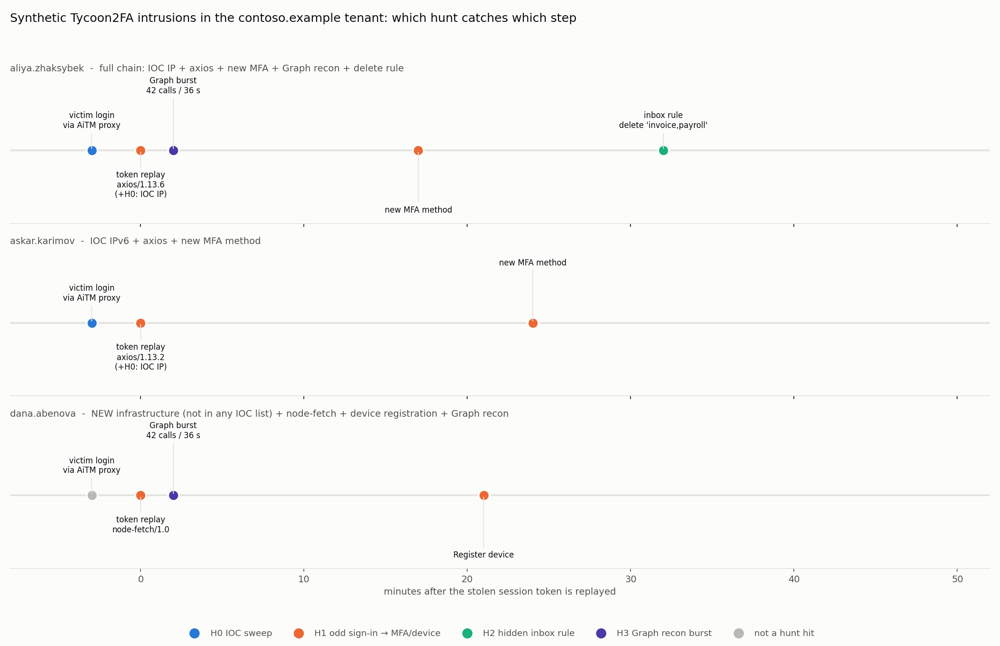

# Week 5 — Threat Hunting Concept (hypothesis-driven hunts for Tycoon2FA)

**Group:** CS-2426 · Dilnaz Estaikyzy, Ademi Akmaganbet  
**Case study:** Tycoon2FA AiTM Phishing-as-a-Service kit

**Syllabus tasks (§3.3, Week 5):** (1) build a hypothesis-driven hunting scenario; (2) execute hunt queries in Splunk or ELK.
Lecture topics: hunting models (intel-driven, hypothesis-driven). Recommended reading: Microsoft Threat Hunting Guide, P. Smith *Practical Threat Hunting*, C. Maurice *The Foundations of Threat Hunting*.

| What we produced | File |
|---|---|
| Hunting dataset: 4,858 Entra ID / Microsoft 365 events (7 days, 62 accounts) with 3 hidden Tycoon2FA intrusions | [`hunting/hunt_logs.ndjson`](hunting/hunt_logs.ndjson), generated by [`hunting/generate_logs.py`](hunting/generate_logs.py) |
| 4 hunts written for **Elastic (ES\|QL + EQL)** and **Splunk (SPL)** | [`hunting/queries_esql.txt`](hunting/queries_esql.txt), [`hunting/queries_spl.txt`](hunting/queries_spl.txt) |
| Hunts executed, findings and scoring | [`hunting/run_hunts.py`](hunting/run_hunts.py) → [`hunting/hunt_results.txt`](hunting/hunt_results.txt) |
| Attack timeline: which hunt catches which step | [`hunting/hunt_timeline.png`](hunting/hunt_timeline.png) |
| New detection rule built from the best hunt (hunt → detection) | [`hunting/sigma_new_mfa_after_nonbrowser_signin.yml`](hunting/sigma_new_mfa_after_nonbrowser_signin.yml) |

## 1. Hunting models used

| Model | Idea | Our hunt |
|---|---|---|
| **Intel-driven** | Start from threat intelligence (IOCs, reports) and search for it | **H0**: sweep sign-in logs for the 76 Tycoon2FA egress IPs from our Week 3 dataset |
| **Hypothesis-driven** | Start from a testable statement about attacker *behaviour* (TTP), then collect evidence to prove or disprove it | **H1–H3**: built from the three gaps found in the Week 4 Kill Chain analysis |

We follow the usual hunting loop (as in the PEAK / TaHiTI process): **Hypothesis → Data → Query → Investigate → Tune → Turn into a detection**.

## 2. The hunting environment

We have no access to a real company's Microsoft 365 logs. We therefore **simulated a small tenant**, `contoso.example` (60 employees and 2 service accounts, 16–22 March 2026), with `hunting/generate_logs.py`.

- **Normal background:** office and home sign-ins with browsers and Outlook, normal Microsoft Graph usage, 6 users adding a new phone as their MFA method, and 12 harmless inbox rules (newsletters, Jira).
- **3 hidden intrusions**, built from Microsoft's, Elastic's and eSentire's description of Tycoon2FA. The attacker IPs and User-Agents come from **our real dataset** (Week 3):

| Victim | What the attacker did |
|---|---|
| aliya.zhaksybek | Token replay from `142.252.171.135` (IOC) with `axios/1.13.6` → new MFA method → Graph recon burst → inbox rule that deletes "invoice, payroll, payment, bank" |
| askar.karimov | Token replay from the IOC IPv6 `2a0d:5600:8:94::f2cd:9d43` with `axios/1.13.2` → new MFA method |
| dana.abenova | Token replay from **new infrastructure that is in no IOC list** (`203.0.113.77`) with `node-fetch/1.0` → device registration → Graph recon burst |

- **3 false-positive traps** that look suspicious but are benign: a reporting script with a `python-requests` User-Agent, a backup application that makes 120 Graph calls every night, and a user who creates a "delete promo mail" rule from the office.

The answer key is in `hunting/ground_truth.json`. The hunts never read it; it is used only for scoring.

| Log type (`log_type`) | Real-world source | Events |
|---|---|---|
| `signin` | Entra ID SigninLogs | 1,962 |
| `audit` | Entra ID AuditLogs (security info, device registration) | 9 |
| `mailbox` | Exchange / OfficeActivity (New-InboxRule) | 14 |
| `graph` | MicrosoftGraphActivityLogs | 2,873 |

## 3. Hypotheses

| ID | Hypothesis | ATT&CK | Data | Why we believe it (intel) |
|---|---|---|---|---|
| **H0** | Accounts in our tenant signed in from known Tycoon2FA egress IPs. | T1078.004 | signin | eSentire IOC list (Week 3 dataset) |
| **H1** | An attacker who replays a stolen session (non-browser User-Agent such as axios / node-fetch) registers **a new MFA method or device within 60 minutes** to keep access. | T1550.004 → **T1098.005** | signin + audit | Microsoft 2026: "registering new authenticator apps"; Elastic 2026: device registration → PRT |
| **H2** | Soon after a sign-in from an unknown hosting network, the attacker creates an **inbox rule that deletes or hides** finance-related mail. | **T1564.008** | signin + mailbox | Microsoft 2026: inbox rules "to hide their activity" |
| **H3** | The attacker maps the tenant with a **burst of Microsoft Graph calls**: many different endpoints in under a minute. | **T1087.004** | graph | Elastic 2026: "dozens of requests within 30–60 seconds" |

## 4. Hunt queries

All queries are in [`hunting/queries_esql.txt`](hunting/queries_esql.txt) (Elastic) and [`hunting/queries_spl.txt`](hunting/queries_spl.txt) (Splunk). Example: **H1** in both languages.

**Elastic ES|QL** (Kibana → Discover → ES|QL, index `tycoon2fa-hunt`):

```sql
FROM tycoon2fa-hunt
| WHERE (log_type == "signin" AND result == "success" AND (user_agent LIKE "axios/*" OR user_agent LIKE "node-fetch*"
         OR user_agent LIKE "undici*" OR user_agent == "node" OR user_agent LIKE "python-requests*"))
     OR (log_type == "audit" AND operation IN ("User registered security info", "Register device"))
| EVAL signin_ts = CASE(log_type == "signin", @timestamp), reg_ts = CASE(log_type == "audit", @timestamp)
| EVAL day = DATE_TRUNC(1 day, @timestamp)
| STATS odd_signin = MIN(signin_ts), registered = MAX(reg_ts), user_agents = VALUES(user_agent), ips = VALUES(src_ip) BY user, day
| WHERE odd_signin IS NOT NULL AND registered IS NOT NULL
| EVAL minutes_after = DATE_DIFF("minute", odd_signin, registered)
| WHERE minutes_after >= 0 AND minutes_after <= 60
```

**Elastic EQL**, the exact time-ordered version (Security → Timelines → Correlation):

```
sequence by user with maxspan=60m
  [any where log_type == "signin" and result == "success" and (user_agent like~ "axios/*" or user_agent like~ "node-fetch*" or ...)]
  [any where log_type == "audit" and operation in ("User registered security info", "Register device")]
```

**Splunk SPL:**

```
index=tycoon2fa ((log_type=signin result=success (user_agent="axios/*" OR user_agent="node-fetch*" OR ...))
   OR (log_type=audit (operation="User registered security info" OR operation="Register device")))
| bin _time span=1d AS day
| stats min(eval(if(log_type="signin", _time, null()))) AS odd_signin max(eval(if(log_type="audit", _time, null()))) AS registered BY user day
| where isnotnull(odd_signin) AND isnotnull(registered) AND registered>=odd_signin AND registered-odd_signin<=3600
```

**Executing the hunts.** We could not run a Splunk or Elastic server in our environment. `hunting/run_hunts.py` therefore loads the same logs into SQLite and runs the same logic as SQL, so anyone can repeat the hunt with one command. We cross-checked the ES|QL aggregation logic with pandas and got the same users. To run the hunts in Elastic, upload `hunt_logs.ndjson` with Kibana *Upload a file* (index `tycoon2fa-hunt`) and paste the queries.

## 5. Results

```text
$ python3 hunting/run_hunts.py
hunt | technique | flagged users | true positives | false positives | compromised users not flagged
H0   | T1078.004 | 2 | 2 | 0 | 1
H1a  | T1550.004 | 4 | 3 | 1 | 0     <- step 1 only: also flags the python-requests reporting script
H1   | T1098.005 | 3 | 3 | 0 | 0     <- step 2 (correlated): the script is gone, all 3 victims remain
H2   | T1564.008 | 1 | 1 | 0 | 2     <- only aliya created a rule (expected)
H3a  | T1087.004 | 3 | 2 | 1 | 1     <- raw: also flags the nightly backup app
H3   | T1087.004 | 2 | 2 | 0 | 1     <- tuned (>= 8 different endpoints): backup app gone
Combined (H0 + H1 + H2 + H3): 3/3 compromised users found, 0 false positives
```



**Findings for each hunt:**

- **H0 (intel-driven) found 2 of 3.** It found aliya and askar because their attacker IPs are in the eSentire list. It **missed dana**, whose attacker used new infrastructure. This shows the Pyramid of Pain in practice: IP indicators are cheap for the attacker to change.
- **H1 is the strongest hunt: 3 of 3, 0 false positives.** Step 1 alone (non-browser User-Agent) also flagged the internal `python-requests` reporting script. Adding the second condition, "a new MFA method or device within 60 minutes", removed it. The time between token replay and the new MFA method was **17–24 minutes**.
- **H2 found aliya's rule** `Name="."; SubjectOrBodyContains=invoice,payroll,payment,bank; DeleteMessage=True`, created 35 minutes after the risky sign-in. The rule name is a single dot, a typical attacker trick to make it look empty. The helpdesk user's "delete promo mail" rule was **not** flagged, because it came from the office network after a normal sign-in.
- **H3 needed tuning.** The first version flagged the nightly backup app (120 calls in 47 s, but only 3 different endpoints). Requiring **at least 8 different endpoints** separates reconnaissance (the attacker used 12 endpoints: roles, organisation, contacts?$top=1000, Conditional Access policies…) from bulk export.

## 6. From hunt to detection

The most precise hunt, H1, was turned into a permanent detection: [`hunting/sigma_new_mfa_after_nonbrowser_signin.yml`](hunting/sigma_new_mfa_after_nonbrowser_signin.yml). It contains two base Sigma rules (non-browser sign-in; new MFA method or device) and a **Sigma correlation rule** (`temporal_ordered`, 60 minutes, grouped by user).

This closes three gaps from Week 4. Kill Chain coverage rises from **11 to 14 of 23 techniques (60%)**, and the **Installation** stage is now covered:

| Technique | Week 4 | Week 5 |
|---|---|---|
| T1098.005 Device Registration (new MFA method / device) | ❌ | ✅ H1 + Sigma correlation |
| T1564.008 Email Hiding Rules | ❌ | ✅ H2 |
| T1087.004 Cloud Account Discovery (Graph recon) | ❌ | ✅ H3 |

The updated diagram and ATT&CK Navigator layer are in [`killchain/`](killchain/).

## 7. Response (what we would do for the 3 users)

Following Microsoft's incident response guidance for AiTM attacks:
1. Revoke all sessions and refresh tokens, and reset the password.
2. **Delete the attacker's MFA method and registered device.** A password reset alone does not remove them.
3. Delete the malicious inbox rule and check what was deleted or forwarded.
4. Block `203.0.113.77` and add it to MISP as a **new indicator**: the hunt produced new threat intelligence.
5. Move the users to phishing-resistant MFA (FIDO2 / passkeys).

## 8. Limitations

- The data is synthetic. Real logs are bigger and noisier, so thresholds (60 min, 20 calls, 8 endpoints) must be re-tuned on real data.
- ES|QL and SPL compare events within the same day. The exact "followed within N minutes" logic is the EQL sequence or the SQL in `run_hunts.py`.
- Real attackers may use a browser-like User-Agent. H1 would then miss them, and H2/H3 or IOC matching become more important. This is why we keep several hunts.

## 9. Summary of the week

- We built **4 hunts**: 1 intel-driven and 3 hypothesis-driven, based on the Week 4 gaps.
- We hunted through a **4,858-event** Microsoft 365 dataset with 3 hidden Tycoon2FA intrusions and 3 false-positive traps. The queries are written for Elastic (ES|QL, EQL) and Splunk (SPL) and executed with SQLite.
- Combined, the hunts found **all 3 compromised accounts with 0 false positives**. The IOC sweep alone found only 2.
- The best hunt became a **Sigma correlation rule**, and our ATT&CK coverage grew from **47% to 60%**.
