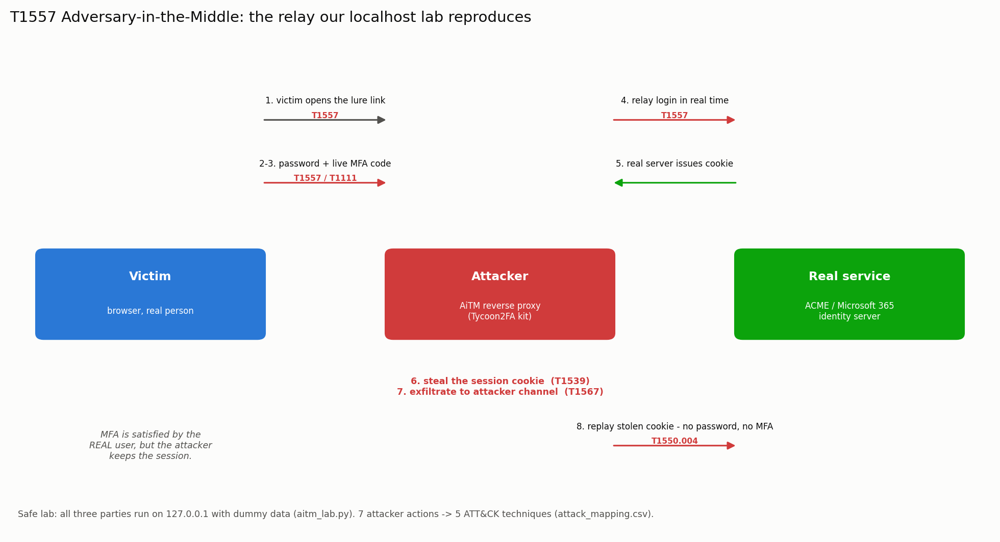

# Week 6 — The ATT&CK Framework (deep dive on T1557 + a safe attack simulation)

**Group:** CS-2426 · Dilnaz Estaikyzy, Ademi Akmaganbet  
**Case study:** Tycoon2FA AiTM Phishing-as-a-Service kit

**Syllabus tasks (§3.3, Week 6):** (1) study one specific ATT&CK technique in depth (e.g. T1059); (2) simulate an attack and map the results to ATT&CK tactics and techniques.
Source: <https://attack.mitre.org>. Recommended reading: MITRE ATT&CK Navigator documentation.

> The syllabus example technique is T1059 (Command-Line Interface). We instead study **T1557 — Adversary-in-the-Middle**, because it is *the* defining technique of our case study, Tycoon2FA.

| What we produced | File |
|---|---|
| Safe, self-contained localhost simulation of the T1557 relay (no real brand, domain or credential) | [`attack_sim/aitm_lab.py`](attack_sim/aitm_lab.py) |
| Captured transcript + attacker event log from the run | [`attack_sim/sim_capture.log`](attack_sim/sim_capture.log), [`attack_sim/attack_events.ndjson`](attack_sim/attack_events.ndjson) |
| Mapping of every simulated action to ATT&CK | [`attack_sim/map_to_attack.py`](attack_sim/map_to_attack.py) → [`attack_sim/attack_mapping.csv`](attack_sim/attack_mapping.csv) |
| ATT&CK Navigator layer of the techniques the run exercised | [`attack_sim/attack_run_layer.json`](attack_sim/attack_run_layer.json) |
| Mechanism diagram | [`attack_sim/t1557_mechanism.png`](attack_sim/t1557_mechanism.png) |

## 1. The technique: T1557 — Adversary-in-the-Middle

| Field | Value (from attack.mitre.org) |
|---|---|
| ID | **T1557** |
| Tactics | **Credential Access (TA0006)**, **Collection (TA0009)** |
| Platforms | Windows, Linux, macOS, Network Devices |
| Sub-techniques | T1557.001 Name Resolution Poisoning / SMB Relay · T1557.002 ARP Cache Poisoning · T1557.003 DHCP Spoofing · T1557.004 Evil Twin |

**What it means.** The attacker positions themselves *between* two parties that think they are talking directly. All traffic flows through the attacker, who can read it, change it or steal it.

**How Tycoon2FA uses it (the procedure).** Tycoon2FA is a **web** AiTM, which the four classic network sub-techniques (ARP, DHCP, DNS, Evil Twin) do not fully describe. Instead of poisoning the network, the kit puts a **reverse proxy** between the victim's browser and the real Microsoft 365 login:

1. The victim opens a lure link and lands on the kit's server.
2. The kit shows a pixel-perfect copy of the Microsoft login and forwards every keystroke to the **real** Microsoft server in real time.
3. The real server sends the genuine MFA prompt; the victim approves it.
4. Microsoft issues a **session cookie**, which the kit steals. From then on the attacker replays that cookie and no longer needs the password or MFA.

This is why Tycoon2FA defeats SMS codes, one-time passcodes and push notifications: the **real user** satisfies the MFA, and the attacker simply keeps the resulting session. The matching sub-technique for that last step is **T1550.004 (Use Alternate Authentication Material: Web Session Cookie)**, and the theft itself is **T1539 (Steal Web Session Cookie)**.

**MITRE mitigations for T1557** (and whether they help here):

| Mitigation | Helps against Tycoon2FA? |
|---|---|
| M1017 User Training ("distrust certificate errors") | Partly — but the kit uses a valid TLS certificate, so there is no error to notice |
| M1041 Encrypt Sensitive Information | No — the traffic *is* encrypted; the proxy terminates the TLS itself |
| M1031 Network Intrusion Prevention | Partly — can block known kit domains/IPs (our Week 2–3 IOCs) |
| **Phishing-resistant MFA (FIDO2 / passkeys)** | **Yes** — the only real fix; the key is bound to the real domain, so the proxy gets nothing to relay |

The last row is the key defensive insight and ties back to our Week 4 courses-of-action matrix.

## 2. The simulation (safe, controlled lab)

**Ethics and safety first.** We do **not** run, rebuild or distribute Tycoon2FA. We built a tiny lab that demonstrates the *mechanism* of T1557 only, with everything fake and local:

- all three parties run on **127.0.0.1** (localhost): a victim client, the attacker's reverse proxy, and a fake "ACME Corp" identity server written by us;
- the credentials are dummy (`alice@acme.example` / `Passw0rd!`), the MFA code is a fixed fake number, and there is **no real brand or domain**;
- nothing leaves the machine; it uses only the Python standard library.

This is the standard, ethical way to study an attack technique: reproduce the behaviour in a closed lab and map what it produces to ATT&CK.

Run it:

```bash
python3 attack_sim/aitm_lab.py      # runs the relay, writes sim_capture.log + attack_events.ndjson
python3 attack_sim/map_to_attack.py # maps the run to ATT&CK, writes attack_mapping.csv + the Navigator layer
python3 attack_sim/plot_t1557.py    # draws t1557_mechanism.png
```

Transcript of the run ([`attack_sim/sim_capture.log`](attack_sim/sim_capture.log)):

```text
[victim] opening login page via link in phishing email -> http://127.0.0.1:8722
[victim] typing password and the MFA code from the authenticator app
[proxy] intercepted credentials  user=alice@acme.example password=Passw0rd!
[proxy] intercepted live MFA code otp=314159
[proxy] STOLE session cookie   ACMEAUTH=ACME-SESSION-3eb3e1ece82045b897e5318d5eda7132
[victim] login looks successful: {'status': 'ok', 'user': 'alice@acme.example'}  (victim suspects nothing)
[attacker] replaying stolen cookie from its own server (axios), no password needed
[attacker] access as alice@acme.example granted = True  <-- MFA fully bypassed
```



## 3. Mapping the simulation to ATT&CK

The lab produced **7 attacker actions**, which map to **5 ATT&CK techniques** across 3 tactics ([`attack_sim/attack_mapping.csv`](attack_sim/attack_mapping.csv)):

| Step | Simulated action | ATT&CK | Tactic |
|---|---|---|---|
| 1 | Serve the fake login page via reverse proxy | **T1557** Adversary-in-the-Middle | Credential Access |
| 2 | Capture the password in transit | **T1557** | Credential Access |
| 3 | Capture the live MFA code | **T1111** Multi-Factor Authentication Interception | Credential Access |
| 4 | Relay the login to the real server in real time | **T1557** | Credential Access |
| 5 | Steal the issued session cookie | **T1539** Steal Web Session Cookie | Credential Access |
| 6 | Exfiltrate the cookie to the attacker channel | **T1567** Exfiltration Over Web Service | Exfiltration |
| 7 | Replay the stolen cookie to act as the victim | **T1550.004** Web Session Cookie | Defense Evasion |

The matching ATT&CK Navigator layer is [`attack_sim/attack_run_layer.json`](attack_sim/attack_run_layer.json) (open at <https://mitre-attack.github.io/attack-navigator/> → *Open Existing Layer*). All five techniques were already in our Week 4 map and are **covered by our detections** (Weeks 3 and 5), so the simulation confirms our coverage against a real run of the behaviour rather than against the vendor description alone.

## 4. Why the simulation matters for detection

- **T1111 (MFA interception)** has no endpoint artifact — the code is stolen in transit. It can only be inferred from the *result*: a successful sign-in from attacker infrastructure. That is exactly our Week 5 hunt H1.
- **T1539 / T1550.004 (cookie theft and replay)** are what make the attack survive a password reset. They are detected by the behaviour that follows (new MFA device, sign-in with the `axios` User-Agent), not by the theft itself.
- This is the core ATT&CK lesson: a single technique (T1557) is best detected by the **chain of techniques around it**, not in isolation.

## 5. Summary of the week

- We studied **T1557 (Adversary-in-the-Middle)** in depth: its tactics, sub-techniques, the exact Tycoon2FA procedure, and the MITRE mitigations (only phishing-resistant MFA truly stops it).
- We built a **safe localhost simulation** of the T1557 relay with fully fake data and reproduced the full chain: credential capture → MFA interception → real-time relay → cookie theft → replay with MFA bypassed.
- We mapped the **7 simulated actions to 5 ATT&CK techniques** and produced a Navigator layer, confirming the techniques our detections already cover.
