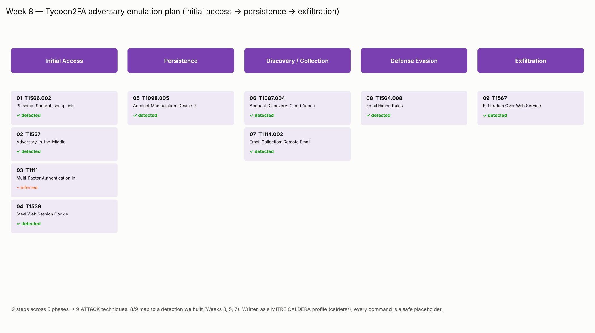

# Week 8 — Creating a Plan to Emulate an Attacker's Action

**Group:** CS-2426 · Dilnaz Estaikyzy, Ademi Akmaganbet  
**Case study:** Tycoon2FA AiTM Phishing-as-a-Service kit

**Syllabus tasks (§3.3, Week 8):** (1) develop a simple adversary emulation plan (initial access → persistence → data exfiltration); (2) document the plan using ATT&CK techniques.
Sources: MITRE Engenuity, Red Teaming resources. Recommended reading: MITRE CALDERA documentation; K. Wilhoit, *Operationalizing Threat Intelligence* (2022).

| What we produced | File |
|---|---|
| The emulation plan (one source of truth) | [`emulation/emulation_plan.json`](emulation/emulation_plan.json) |
| The plan as a table: phase → ATT&CK → procedure → safe command → our detection | [`emulation/emulation_plan.csv`](emulation/emulation_plan.csv) |
| A **MITRE CALDERA adversary profile** + one ability per step (safe placeholders) | [`emulation/caldera/adversary_tycoon2fa.yml`](emulation/caldera/adversary_tycoon2fa.yml), [`emulation/caldera/abilities/`](emulation/caldera/abilities/) |
| A safe dry-run that "executes" the plan in order (like CALDERA) | [`emulation/run_emulation.py`](emulation/run_emulation.py) → [`emulation/emulation_run.log`](emulation/emulation_run.log) |
| ATT&CK Navigator layer + diagram | [`emulation/emulation_layer.json`](emulation/emulation_layer.json), [`emulation/emulation_plan.png`](emulation/emulation_plan.png) |

## 1. What an adversary emulation plan is

An **adversary emulation plan** is a step-by-step script that reproduces how a *specific* real adversary behaves, so a blue team can test whether it would detect that adversary. It is more targeted than generic penetration testing: every step is tied to a real ATT&CK technique the adversary is known to use.

**MITRE CALDERA** is the standard tool for this. In CALDERA you write:
- **abilities** — one action each, tagged with its ATT&CK tactic and technique, with the command to run;
- an **adversary profile** — an ordered list of abilities (`atomic_ordering`).
CALDERA then runs the profile on an agent and records what happened, generating telemetry for the defenders.

We wrote our plan in exactly this format.

## 2. Safety

This is a **plan and a safe emulation**, not an attack. We do **not** run, rebuild or weaponise Tycoon2FA. Every CALDERA ability in our plan runs a **harmless placeholder** — an `echo` that just logs the step (for example, `echo '[emulate] registered attacker device'`). Running the plan produces a realistic *ordered execution log* with no real email, no real proxy against a real service, and no real data. The one step that "runs" is the Week 6 localhost lab, which is itself entirely local and fake.

This is the normal, ethical way to build an emulation plan for coursework: the value is in the **structure and the ATT&CK mapping**, not in weaponised commands.

## 3. The plan (initial access → persistence → data exfiltration)

Ordered as the syllabus asks, with the realistic intermediate phases added. Full table: [`emulation/emulation_plan.csv`](emulation/emulation_plan.csv).



| # | Phase | ATT&CK | Procedure (what Tycoon2FA does) | Our detection |
|---|---|---|---|---|
| 1 | **Initial Access** | T1566.002 Spearphishing Link | Lure email with a link / QR / SVG to the AiTM proxy | E-mail IOCs; YARA on HTML/SVG |
| 2 | Initial Access | T1557 Adversary-in-the-Middle | Reverse proxy relays the login in real time | Week 6 sim; relay-IP IOCs |
| 3 | Initial Access | T1111 MFA Interception | Capture the live MFA code in transit | Inferred (Week 5 H1) |
| 4 | Initial Access | T1539 Steal Web Session Cookie | Steal the session cookie issued after MFA | Week 5 Sigma (axios UA) |
| 5 | **Persistence** | T1098.005 Device Registration | Register attacker MFA/device → survives password reset | Week 5 H1 + Sigma correlation |
| 6 | Discovery / Collection | T1087.004 Cloud Account Discovery | Burst of Microsoft Graph calls (recon) | Week 5 H3 (Graph burst) |
| 7 | Discovery / Collection | T1114.002 Remote Email Collection | Read mailbox, dump contacts | Mailbox audit; Week 7 CAR |
| 8 | Defense Evasion | T1564.008 Email Hiding Rules | Inbox rule that deletes finance mail | Week 5 H2 (hide/delete rule) |
| 9 | **Exfiltration** | T1567 Exfiltration Over Web Service | Send stolen data out (Telegram bot) | Block Telegram egress; Week 7 CAR |

**9 steps → 9 ATT&CK techniques across 5 phases.** The plan is deliberately built from techniques our own detections already target, so running it is also a **purple-team test** of our coverage.

## 4. The CALDERA profile

[`emulation/caldera/adversary_tycoon2fa.yml`](emulation/caldera/adversary_tycoon2fa.yml) is a real CALDERA adversary profile (`atomic_ordering` lists the nine abilities in order). Each ability is in [`emulation/caldera/abilities/`](emulation/caldera/abilities/), for example:

```yaml
- id: 4416cc4e-ff29-5481-a135-88f4779bf15d
  name: "05 Account Manipulation: Device Registration"
  description: "Register a new MFA method / device so access survives a password reset."
  tactic: persistence
  technique:
    attack_id: T1098.005
    name: "Account Manipulation: Device Registration"
  platforms:
    linux:
      sh:
        command: |
          echo '[emulate] registered attacker authenticator app / device (PRT)'
```

To run it in a real range: drop the `abilities/` folder into a CALDERA stockpile, import the adversary profile, and run it against a CALDERA agent. Because the commands are benign, it is safe to run anywhere.

## 5. Running the plan (safe dry-run)

We also wrote a standalone runner that executes the plan in order the way CALDERA would, and records the result plus which detection should fire ([`emulation/emulation_run.log`](emulation/emulation_run.log)):

```text
==================== PHASE: Persistence ====================
[05] T1098.005   Account Manipulation: Device Registration
     procedure : Register a new MFA method / device so access survives a password reset.
     result    : [emulate] registered attacker authenticator app / device (PRT)
     DETECTED BY: Week 5 hunt H1 + Sigma correlation (non-browser sign-in -> new MFA within 60 min)
...
# 9 steps emulated across 5 phases.
# 8/9 steps map to a detection we built in Weeks 3, 5 and 7.
```

```bash
python3 emulation/build_plan.py      # rebuilds the CSV, CALDERA profile+abilities, Navigator layer
python3 emulation/run_emulation.py   # safe dry-run of the plan
python3 emulation/plot_emulation.py  # the diagram
```

## 6. Result: the emulation validates our defences

Running the emulation end to end shows that **8 of the 9 steps are covered by a detection we built in earlier weeks** (IOCs/YARA in Week 3, hunts/Sigma in Week 5, the CAR analytic in Week 7). The one step with no direct detection — **T1111 (MFA interception)** — has no telemetry of its own; it is only visible through its result (a successful sign-in from attacker infrastructure), which hunt H1 catches. So the attack is still detected one step later.

This closes the loop of the whole project: we went from **understanding** the threat (Weeks 1–2) to **detecting** it (Weeks 3, 5, 7) to **emulating** it and confirming the detections fire (Week 8).

## 7. Summary of the week

- We built a **simple adversary emulation plan** for Tycoon2FA, ordered **initial access → persistence → data exfiltration** (9 steps, 5 phases).
- We **documented every step with an ATT&CK technique** (9 techniques) and a Navigator layer.
- We wrote the plan as a real **MITRE CALDERA adversary profile** with one ability per step, using **safe placeholder commands**, and ran a safe dry-run.
- The emulation doubles as a **purple-team test**: 8 of 9 steps map to detections we built, and the 9th is caught one step later.
